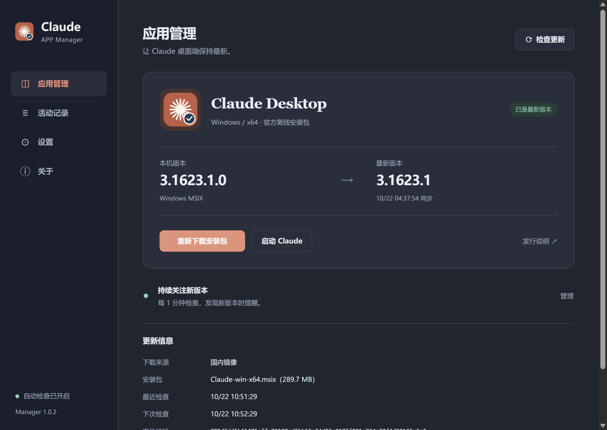

# Claude APP Manager

Claude 桌面端的安装、更新、启动与卸载管理器。参考 [Codex App Manager](https://github.com/Wangnov/Codex-App-Manager) 的功能流程，使用 [Claude App Mirror](https://github.com/Wangnov/claude-app-mirror) 的实时清单与官方离线安装包，独立实现 Electron 桌面客户端。



## 直接使用（Windows x64）

从 [Releases](https://github.com/milu886/claude-app-manager/releases/latest) 下载（本地构建产物位于 `dist/`）：

- `Claude-APP-Manager-1.0.6-x64-portable.exe`：免安装，双击运行。
- `Claude-APP-Manager-1.0.6-x64-setup.exe`：安装版，可选择安装目录与桌面快捷方式。
- `SHA256SUMS.txt`：以上文件的 SHA-256 校验值。

Manager 安装包不包含 Claude 本体；运行后按当前架构下载 Claude。Windows 10/11 需要能够正常使用 MSIX / AppX 安装服务。管理器本身尚未配置 Authenticode 签名，Windows 可能显示发行者未知；这与下载的官方 Claude MSIX 的签名是两回事。

## 功能

- 识别已安装的 Claude MSIX、版本、运行状态与启动入口。
- 每次启动检查更新；默认每分钟轮询，支持 5 / 15 / 30 分钟。
- 下载来源默认“自动（检测最新版本）”：同时检查国内镜像与 GitHub 发布，使用较新的版本，并从所有可用来源同时下载；任一来源失败时由其他来源补上。也可选择“仅 GitHub”。GitHub 版本信息读取发布附带的 `release-manifest.json`（普通下载，不占用 GitHub API 每小时 60 次的未登录配额），仅在其不可用时才调用 API。
- 按 x64 / ARM64 选择安装包，不把版本固定在用户提供的 `3.1623.0`。
- 多连接分段下载：默认 6 个连接、8 MB 分段，镜像、Anthropic 官方 CDN（固定版本地址）与 GitHub 同时分担，较快的来源承担更多分段；连接 30 秒无数据自动重试，网络中断后下次从已完成的分段续传。实测经代理下载 283 MB 用时约 48 秒（单连接约 13 分钟）。
- 显示下载进度、速度与连接数；支持取消、缓存复用与清理。
- 下载校验后立即预安装（`Add-AppxPackage -Stage`，不影响正在运行的 Claude），“完成更新”时只需注册，通常只要数秒。
- 安装包大小与 SHA-256 校验；Windows 安装前验证签名发布者，随后交给 `Add-AppxPackage` 安装。
- 安装前再次检测运行状态、文件与版本，阻止损坏文件和误降级。
- 按程序包标识识别仍占用 Claude 的进程：由 Claude 启动、仍在运行的其他程序（例如 Java 服务）会在“完成更新”前列出并请你确认是否关闭，避免 Windows 等待约 90 秒后强行结束；自动安装从不关闭这些程序。
- 启动 Claude；卸载 Claude MSIX 并请求系统保留个人数据。
- 托盘后台运行、更新通知、登录 Windows 后启动、浅色 / 深色 / 系统主题。
- 设置中可开启发现更新后自动下载，以及 Claude 退出后空闲安装。默认只检查和提醒。

MSIX 更新会区分桌面进程和系统服务。桌面未运行时，管理器会正常停止当前 Claude 包自带的 CoworkVMService 并等待其进程退出，再由 Windows 关闭 Claude 包残留的后台进程完成注册，更新完成后恢复服务；桌面仍在运行时使用 Windows 延后注册机制，保留现有会话。等待状态显示实际占用原因，并提供“完成更新”按钮，支持复用缓存重试；只有检测到目标版本后才报告完成。具体失败会显示 Windows 错误码和原始说明。

## 实时更新的边界

Manager 的轮询只在其进程运行时执行。默认关闭窗口后留在托盘；如果从托盘退出，检查也会停止。需要一直跟随更新时，可开启登录后启动、后台运行、自动下载和空闲安装。

上游镜像约每 15 分钟同步官方版本，所以“每分钟检查”表示及时发现镜像中新发布的版本，不能保证与官方发版零延迟。网络失败时，轮询会指数退避，最长 30 分钟；可以随时手动重试。

镜像仅提供完整的 MSIX / DMG / DEB，没有 Claude 的增量更新包，因此这里使用完整安装包更新。Manager 自身的在线更新尚未配置发布仓库与签名发布流程。

## 开发与构建

需要 Node.js 22.12+（本机验证版本为 24.20.0）、npm，Windows 构建使用当前 Windows 主机：

```powershell
npm ci
npm start
npm run check
npm test
npm run smoke
npm run build
```

如果 npm 安装策略没有自动下载 Electron 运行库，第一次 `npm start` 会触发下载。网络受限时可使用 Electron 官方支持的镜像配置；下载校验不能关闭。当前工作区已经准备好运行库，可运行：

```powershell
npm run build -- --config.electronDist=node_modules/electron/dist
```

其他目标：`npm run build:arm64`、`npm run build:mac`、`npm run build:linux`。本次实际交付和验证的是 Windows x64。macOS / Linux 集成为下载校验后打开系统安装包，尚未在这些系统验证；它们不支持此版本中的自动安装或应用内卸载。macOS DMG 应在 macOS 构建。

用户设置、日志与安装包缓存存储在 Electron 的 `userData` 目录（Windows 通常为 `%APPDATA%\claude-app-manager`）。开发用 `--smoke` 在项目 `.tmp/smoke-profile` 隔离设置，不安装、卸载或启动 Claude。

## 验证

62 项自动化测试覆盖真实本地 HTTP 请求、ETag / 304、镜像失败回退、镜像滞后取较新版本、系统代理网络通道、版本比较、平台选择、下载校验、损坏拦截、取消、超时、重定向约束、降级保护、设置持久化、并发设置写入、PowerShell 中文错误、CLIXML、系统签名模块、延后更新状态和重启后的缓存重试。PowerShell 服务测试验证停止/等待进程退出/安装/恢复顺序、安装失败后的恢复、活跃桌面不被中断、原先停止的服务保持停止，以及精确服务路径归属核验。

桌面冒烟测试核对 preload 桥、页面尺寸、真实镜像版本读取、本机已安装版本识别，以及设置页的浅色与深色显示、占用原因和可用的完成更新按钮。1.0.2 已在本机实际完成 Claude 从 3.1623.0.0 到 3.1623.1.0 的升级，等待记录已清除，CoworkVMService 已恢复运行。卸载、登录启动未在开发验证中执行。

Postman 本地仿真契约和验证方法见 [docs/REFERENCE.md](docs/REFERENCE.md)。该环境中 CLI 仿真受全局目录权限限制，同一个无害安装包 mock 已通过直接本地 HTTP 方式验证。

## 开源说明

本项目采用 MIT 许可；上游项目归属与许可见 [THIRD_PARTY_NOTICES.md](THIRD_PARTY_NOTICES.md)。这是独立第三方工具，与 Anthropic 和 OpenAI 没有隶属关系，不修改 Claude 安装包或授权机制。
